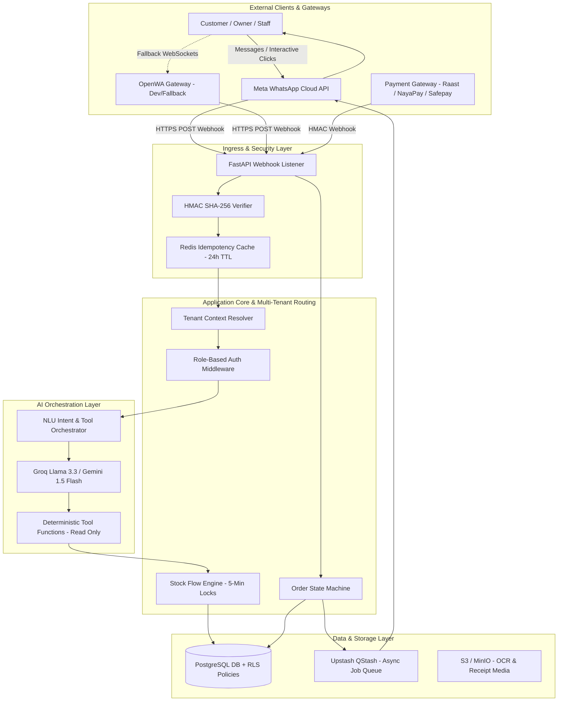

# System Architecture & Data Flow Specification: WhatsApp-First AI Hospitality SaaS

**Document Title:** `07-system-architecture.md`  
**Version:** 1.0  
**Date:** October 16, 2026  
**Primary Reference Sources:** `PRODUCT_REQUIREMENTS.md` [PRD], `OpenWA` Documentation [OpenWA], `02-prd-requirements-analysis.md`, `05-open-wa-gateway-evaluation.md`, `06-technology-stack-and-cost-analysis.md`  
**Status:** Approved Technical Architecture & System Engineering Specification  

---

## Executive Summary & Guiding Architectural Principles

This document specifies the end-to-end system architecture, data flow pipelines, security framework, and AI orchestrator design for the **WhatsApp-First AI Hospitality SaaS** [PRD 1.1]. The platform enables independent restaurants, cloud kitchens, and boutique hotels in Pakistan (and international expansion markets) to automate customer inquiries, interactive food ordering, hotel room service, payment processing, and inventory management entirely within WhatsApp [PRD 1.1, 2.1].

The architectural blueprint is strictly governed by four foundational design principles [PRD 1.2]:

1. **WhatsApp as Primary Operational Interface**: End-customers perform 100% of product discovery, cart building, room verification, payment, and tracking natively in chat with zero web/app redirects [PRD 1.2]. Business owners handle onboarding, menu setup, price edits, stock toggles, and daily sales reports through conversational commands [PRD 1.2, 4.8].
2. **Zero-Trust Financial State Machine**: No order is marked `Paid` or dispatched to the kitchen based on AI LLM inference, customer text claims, typed transaction references, or uploaded receipt screenshots [PRD 1.2, 4.6]. Status transitions occur strictly via cryptographically verified payment gateway webhooks [PRD 1.2, 4.6].
3. **Deterministic Inventory & Pricing Integrity**: All prices, subtotals, delivery fees, taxes, and inventory availability counts are computed and locked by backend database SQL logic [PRD 1.2, 4.5]. The AI LLM handles natural language intent extraction only and possesses **zero write permissions** to database financial or stock tables [PRD 1.2, 4.9].
4. **Strict Multi-Tenant Data Isolation**: Every tenant's data, menu catalog, customer interactions, orders, and API credentials are completely isolated at the database level using PostgreSQL **Row Level Security (RLS)** [PRD 1.2, 5.1].

---

## 1. High-Level Architecture Overview

The system utilizes an asynchronous, event-driven micro-monolith or serverless architecture optimized for high-concurrency webhook ingestion and low-latency response dispatches [PRD 5.1; Doc 06].



---

## 2. End-to-End Message Processing Flow

The lifecycle of an incoming customer or business owner message spans seven discrete, fault-tolerant execution steps [PRD 4.1–4.10]:

```
+---------------------------------------------------------------------------------------------------+
|                                  SEVEN-STEP MESSAGE PROCESSING FLOW                               |
+---------------------------------------------------------------------------------------------------+
| 1. Webhook Ingress    --> 2. HMAC Validation & Deduplication --> 3. Tenant Context Resolution     |
| 4. Role Authorization --> 5. AI NLU Intent & Tool Execution --> 6. DB State Lock & Financial Calc |
| 7. Outbound Formatting & WhatsApp Dispatch                                                        |
+---------------------------------------------------------------------------------------------------+
```

### Step 1: Webhook Ingress & Verification
* The ingress server receives an HTTP POST payload from Meta Cloud API or OpenWA Gateway [PRD 4.3; Doc 05].
* The `FastAPI` router immediately validates the request signature using `X-Hub-Signature-256` against the tenant's app secret [PRD 4.3]. Invalid signatures are rejected instantly with HTTP 401 [PRD 4.3].

### Step 2: Idempotency & Deduplication
* WhatsApp webhooks can deliver duplicate payloads due to network retries [PRD 4.3].
* The backend extracts the unique message ID (`wamid.HBgL...`) and performs an atomic Redis `SETNX` operation with a 24-hour Time-To-Live (TTL) [PRD 4.3].
* If `SETNX` returns 0 (key already exists), the message is identified as a duplicate and dropped immediately with HTTP 200 OK to satisfy Meta's webhook receipt SLA (< 3.0 seconds) [PRD 4.3, 5.1].

### Step 3: Tenant Context Resolution & DB Session Isolation
* The backend inspects the payload `phone_number_id` (Meta) or `session_id` (OpenWA) [PRD 4.3].
* It queries the global tenant registry cache to map the ID to a specific `tenant_id` UUID [PRD 4.3].
* The PostgreSQL database connection sets the session configuration variable:
  ```sql
  SET LOCAL app.current_tenant_id = 'c39e4a82-1234-4567-89ab-cdef01234567';
  ```
  All subsequent queries in the request transaction are automatically restricted by PostgreSQL Row Level Security (RLS) policies [PRD 1.2, 5.1].

### Step 4: Role-Based Routing
The system inspects the sender's WhatsApp phone number against database records [PRD 3.1]:
1. **Unregistered Sender**: Routed to the Onboarding Flow (if messaging the shared SaaS number) or Customer Menu Discovery (if messaging a business number) [PRD 4.1, 4.4].
2. **Customer / Hotel Guest**: Routed to the Interactive Ordering / Guest Request Agent [PRD 4.4]. If `conversations.is_human_handled == TRUE`, automated processing is bypassed, and the message is logged for the human agent [PRD 4.10].
3. **Business Owner / Manager**: Routed to the Conversational Owner Management Agent (price edits, stock toggles, sales queries) [PRD 4.8].
4. **Kitchen / Staff Member**: Routed to the Order Dispatch Handler (`[Accept Order]`, `[Mark Out for Delivery]`) [PRD 4.7].

### Step 5: AI NLU Intent Recognition & Structured Tool Execution
* The prompt orchestrator packages the user message, last 5 conversation history messages, and catalog metadata into a compact JSON payload for Groq Llama 3.3 / Gemini 1.5 Flash [PRD 4.9; Doc 06].
* The LLM identifies the intent (e.g., `SEARCH_MENU`, `ADD_TO_CART`, `CHECK_ROOM_SERVICE`, `UPDATE_PRICE`) and selects deterministic tool functions from the registry [PRD 4.9]:
  * `get_catalog(category_id)`
  * `check_stock_availability(sku_list)`
  * `reserve_stock_hold(cart_items)`
  * `generate_payment_link(order_id)`
  * `update_item_price_owner(item_id, new_price)`
* **Strict Guardrail**: The LLM outputs tool call requests in JSON; it does **not** generate freeform text responses claiming an order is confirmed or a price is changed until the backend tool function returns success [PRD 4.9].

### Step 6: Backend Validation & State Mutation
* Executed tool functions call PostgreSQL database functions [PRD 4.5]:
  * Pricing, subtotals, delivery fees, and taxes are calculated exclusively via SQL statements [PRD 1.2].
  * Real-time stock availability executes an atomic PostgreSQL transaction placing a **5-minute temporary hold** on requested items [PRD 4.5]:
    ```sql
    UPDATE stock_items 
    SET reserved_quantity = reserved_quantity + :qty,
        lock_expires_at = NOW() + INTERVAL '5 minutes'
    WHERE sku = :sku 
      AND (actual_quantity - reserved_quantity) >= :qty;
    ```
* If stock is insufficient, the tool fails gracefully, and the AI suggests available alternatives [PRD 4.5].

### Step 7: Outbound Response Formatting & WhatsApp Dispatch
* The backend formats the response into Meta Interactive List Messages (up to 10 items) or Reply Buttons (up to 3 options) [PRD 4.1].
* For completed orders, single-use payment links (Raast, NayaPay, Safepay, Stripe) are embedded [PRD 4.6].
* Outbound payloads are dispatched asynchronously via HTTP POST to Meta Cloud API or OpenWA Gateway, updating the message log in PostgreSQL [PRD 4.3, 4.7].

---

## 3. Multi-Tenant Data Isolation & Security Architecture

### 3.1 PostgreSQL Row Level Security (RLS) Policy Design
Data security across multi-tenant businesses is guaranteed at the database engine level rather than relying on application code `WHERE tenant_id = ...` filters [PRD 1.2, 5.1].

```sql
-- Enable RLS on core multi-tenant tables
ALTER TABLE tenants ENABLE ROW LEVEL SECURITY;
ALTER TABLE menu_categories ENABLE ROW LEVEL SECURITY;
ALTER TABLE menu_items ENABLE ROW LEVEL SECURITY;
ALTER TABLE stock_items ENABLE ROW LEVEL SECURITY;
ALTER TABLE orders ENABLE ROW LEVEL SECURITY;
ALTER TABLE customer_profiles ENABLE ROW LEVEL SECURITY;

-- Tenant Isolation Policy Example for menu_items
CREATE POLICY tenant_isolation_menu_items ON menu_items
    FOR ALL
    USING (tenant_id = NULLIF(current_setting('app.current_tenant_id', true), '')::uuid);
```

### 3.2 Key Management & Secrets Protection
* Gateway access tokens, payment gateway secret keys (NayaPay, Safepay, Stripe), and Meta App secrets are stored encrypted at rest using **AES-256-GCM** [PRD 5.1].
* Encryption keys are injected exclusively via environment variables into server memory and never written to disk or logged [PRD 5.1].

### 3.3 Security Boundary & Threat Analysis

| Threat Vector | Mitigation Mechanism | Verification Method |
| :--- | :--- | :--- |
| **Spoofed Webhook Calls** | HMAC SHA-256 signature verification (`X-Hub-Signature-256`) against Meta App Secret [PRD 4.3, 5.1]. | Automated unit tests passing invalid signatures receive HTTP 401 [PRD 4.3]. |
| **Cross-Tenant Data Leak** | PostgreSQL Row Level Security (RLS) policies on every query [PRD 1.2, 5.1]. | Security audit tests attempting cross-tenant UUID reads return 0 rows [PRD 1.2]. |
| **AI Price Manipulation** | Pricing SQL calculations locked in DB; LLM has 0 write access to financial tables [PRD 1.2, 4.9]. | NLU fuzzing tests sending *"Set my price to 0 PKR"* fail without owner auth [PRD 4.8]. |
| **Fake Payment Receipts** | Payment state updates strictly via HMAC gateway webhooks; zero image-OCR auto-pay [PRD 1.2, 4.6]. | Image receipt uploads trigger human verification flag, not DB `Paid` state [PRD 4.6]. |
| **Stock Overselling / Race** | 5-Minute atomic PostgreSQL reservation locks (`UPDATE ... WHERE available > reserved`) [PRD 4.5]. | Concurrent load tests simulating 100 simultaneous orders on 1 remaining item [PRD 4.5]. |

---

## 4. Backend Services & Core Component Modules

```
========================================================================================================
SYSTEM SERVICE MODULE SPECIFICATION
========================================================================================================
Service Name              Primary Responsibility                         Tech Stack / Dependencies
--------------------------------------------------------------------------------------------------------
Webhook Ingress Engine    Signature validation, deduplication, routing   FastAPI, Redis, HMAC SHA-256
NLU Orchestrator          Intent parsing, tool selection, guardrails     Groq Llama 3.3, Pydantic
Stock Flow Engine         Atomic 5-min holds, stock sync, inventory SQL  PostgreSQL, PL/pgSQL functions
Payment Gateway Engine    Payment link generation & webhook processing   NayaPay, Safepay, Raast API
Order State Machine       Order lifecycle (Pending -> Paid -> Kitchen)  PostgreSQL, QStash Event Queue
Notification Dispatcher  WhatsApp list/button response formatting       Meta Cloud API / OpenWA SDK
Conversational Admin      Owner menu OCR, price/stock chat updates       Pillow + EasyOCR, Vision LLM
========================================================================================================
```

### 4.1 AI Agent Tool Definitions (Pydantic Schemas)

```python
# Conceptual Pydantic Tool Schemas for AI Orchestrator

class SearchMenuInput(BaseModel):
    category_name: Optional[str] = Field(None, description="Menu category like Pizza, Drinks")
    query: Optional[str] = Field(None, description="Item search keyword")

class ReserveStockInput(BaseModel):
    customer_phone: str = Field(..., description="Customer WhatsApp phone number")
    items: List[Dict[str, Any]] = Field(..., description="List of dicts containing SKU and quantity")

class OwnerUpdatePriceInput(BaseModel):
    item_id: str = Field(..., description="UUID of the menu item")
    new_price: float = Field(..., description="New price in tenant base currency")
    confirm_token: Optional[str] = Field(None, description="Confirmation token for double verification")
```

---

## 5. Validation, Error Handling & Human Escalation

### 5.1 Error Handling & Retry Policies
1. **Webhook Ingress Failure**: Ingress endpoint returns HTTP 200 OK within 2.5 seconds to prevent Meta from disabling webhooks [PRD 5.1]. Long-running tasks (OCR, payment links) offload immediately to background workers via Upstash QStash [PRD 4.2, 4.5].
2. **Payment Webhook Retries**: Gateway payment webhooks retry with exponential backoff (1m, 5m, 15m, 1h) if the SaaS backend returns non-2xx [PRD 4.6].
3. **5-Minute Stock Hold Expiration**: An automated background job (Upstash QStash cron trigger) scans for expired stock reservations every 60 seconds:
   ```sql
   UPDATE stock_items 
   SET reserved_quantity = GREATEST(0, reserved_quantity - lock_qty)
   WHERE lock_expires_at < NOW() AND order_status = 'Pending_Payment';
   ```

### 5.2 Human Agent Escalation Workflow
When a customer sends explicit triggers (*"talk to human"*, *"agent"*, *"manager"*, *"complaint"*) or sentiment analysis drops below a **0.65 threshold** [PRD 4.10]:

```
[ Customer Chat ] --> [ Trigger Detected / Sentiment < 0.65 ]
                              │
                              ▼
        [ Update DB: conversations.is_human_handled = TRUE ]
                              │
                              ▼
        [ Pause Automated AI NLU for Customer Thread ]
                              │
                              ▼
  [ Send Urgent Alert to Staff WhatsApp Group with Direct Link ]
                              │
                              ▼
       [ Staff Tap Button: "Takeover Conversation" ]
```

---

## 6. Database Schema Design (PostgreSQL DDL Core)

```sql
-- CORE DATABASE SCHEMA (POSTGRESQL)

CREATE EXTENSION IF NOT EXISTS "uuid-ossp";

-- 1. Tenants Table
CREATE TABLE tenants (
    id UUID PRIMARY KEY DEFAULT uuid_generate_v4(),
    business_name VARCHAR(255) NOT NULL,
    business_type VARCHAR(50) NOT NULL, -- 'Restaurant', 'Hotel', 'Both'
    phone_number_id VARCHAR(100) UNIQUE NOT NULL, -- Meta Phone Number ID
    currency VARCHAR(10) DEFAULT 'PKR',
    timezone VARCHAR(50) DEFAULT 'Asia/Karachi',
    is_active BOOLEAN DEFAULT TRUE,
    created_at TIMESTAMPTZ DEFAULT NOW()
);

-- 2. Menu Items & Services
CREATE TABLE menu_items (
    id UUID PRIMARY KEY DEFAULT uuid_generate_v4(),
    tenant_id UUID NOT NULL REFERENCES tenants(id) ON DELETE CASCADE,
    category_name VARCHAR(100) NOT NULL,
    item_name VARCHAR(255) NOT NULL,
    description TEXT,
    price NUMERIC(10, 2) NOT NULL,
    sku VARCHAR(100) NOT NULL,
    is_available BOOLEAN DEFAULT TRUE,
    created_at TIMESTAMPTZ DEFAULT NOW(),
    UNIQUE(tenant_id, sku)
);

-- 3. Inventory & Stock Locks (Stock Flow)
CREATE TABLE stock_items (
    id UUID PRIMARY KEY DEFAULT uuid_generate_v4(),
    tenant_id UUID NOT NULL REFERENCES tenants(id) ON DELETE CASCADE,
    menu_item_id UUID NOT NULL REFERENCES menu_items(id) ON DELETE CASCADE,
    actual_quantity INT NOT NULL DEFAULT 0,
    reserved_quantity INT NOT NULL DEFAULT 0,
    lock_expires_at TIMESTAMPTZ,
    updated_at TIMESTAMPTZ DEFAULT NOW()
);

-- 4. Orders Table
CREATE TABLE orders (
    id UUID PRIMARY KEY DEFAULT uuid_generate_v4(),
    tenant_id UUID NOT NULL REFERENCES tenants(id) ON DELETE CASCADE,
    order_number VARCHAR(50) NOT NULL, -- e.g. #ORD-1042
    customer_phone VARCHAR(50) NOT NULL,
    total_amount NUMERIC(10, 2) NOT NULL,
    payment_status VARCHAR(50) DEFAULT 'Pending', -- 'Pending', 'Paid', 'COD_Confirmed', 'Failed'
    order_status VARCHAR(50) DEFAULT 'Received', -- 'Received', 'Accepted', 'Preparing', 'Out_for_Delivery', 'Completed'
    payment_link_id VARCHAR(255),
    room_number VARCHAR(50), -- Nullable for restaurants; required for hotels
    created_at TIMESTAMPTZ DEFAULT NOW()
);
```

---

## 7. Practical Low-Cost MVP Architecture vs. Scale Path

### 7.1 MVP Architecture ($0 – $15 / month)
* **Ingress & API**: FastAPI hosted on Render / Railway / Fly.io ($7/mo persistent host to prevent cold-start webhook timeouts) [PRD 5.1; Doc 06].
* **Database**: Supabase Free Tier (500 MB PostgreSQL, built-in RLS) [Doc 06].
* **Queue & Cache**: Upstash Free Tier (Redis 10k requests/day + QStash background messaging) [Doc 06].
* **AI Model**: Groq Cloud Free Tier (Llama 3.3 70B @ 300 requests/min) / Gemini 1.5 Flash [Doc 06].
* **WhatsApp Gateway**: Meta Official Cloud API (1,000 free monthly Service conversations per phone number) [PRD 2.1; Doc 05].

### 7.2 Production Scale Architecture (>50 Merchant Tenants)
* **Ingress**: AWS ECS Fargate or Hetzner VPS cluster with Nginx load balancer ($25–$45/mo).
* **Database**: Supabase Pro / Managed AWS Aurora PostgreSQL with automated failover ($25/mo).
* **Cache**: Upstash Pro / Managed Redis cluster.
* **AI Engine**: Hybrid routing (Groq primary for fast tool calls, OpenAI GPT-4o-mini for complex multi-lingual fallback).
* **Expected Margin**: >94% gross margin at $30/month per merchant subscription [Doc 06].

---

## 8. Unresolved Technical Decisions & Recommendations

1. **Raast P2M Direct API Availability**: State Bank of Pakistan's Raast P2M offers 0% transaction fees [PRD 2.1]. However, direct commercial API access requires integration via authorized merchant acquirers (e.g., NayaPay Arc, Safepay, or Bank Alfalah) [PRD 4.6].  
   * *Recommendation*: Launch MVP using NayaPay Arc / Safepay payment links which wrap Raast, JazzCash, and EasyPaisa into a single unified webhook interface [PRD 4.6].
2. **Meta Cloud API vs. OpenWA Dual Engine Strategy**:  
   * *Recommendation*: Use Meta Official Cloud API for all production merchant accounts to eliminate account ban risks [PRD 1.1; Doc 05]. Retain OpenWA in Docker Compose (`docker-compose.dev.yml`) strictly for local offline engineering tests [OpenWA 5; Doc 05].

---

## 9. Traceability & Source References

| Architectural Claim / Requirement | Primary Source | Document Reference |
| :--- | :--- | :--- |
| **WhatsApp Primary Interface** | `PRODUCT_REQUIREMENTS.md` Section 1.2 | [PRD 1.2] |
| **Zero-Trust Financial State Machine** | `PRODUCT_REQUIREMENTS.md` Section 1.2 & 7 | [PRD 1.2, 7] |
| **5-Minute Atomic Stock Lock** | `PRODUCT_REQUIREMENTS.md` Section 4.5 | [PRD 4.5] |
| **Meta Embedded Signup OAuth** | `PRODUCT_REQUIREMENTS.md` Section 3.1, 4.3 | [PRD 3.1, 4.3] |
| **OpenWA Gateway Evaluation** | `05-open-wa-gateway-evaluation.md` | [Doc 05] |
| **Tech Stack & Unit Economics** | `06-technology-stack-and-cost-analysis.md` | [Doc 06] |
