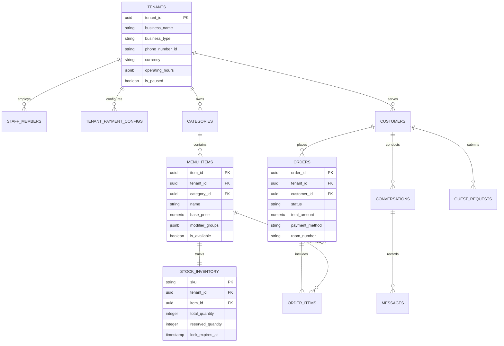

# Database Architecture & Multi-Tenancy Design: WhatsApp-First AI SaaS

**Document Title:** `08-database-and-multi-tenancy.md`  
**Version:** 1.0  
**Date:** October 16, 2026  
**Primary Reference Sources:** `PRODUCT_REQUIREMENTS.md` [PRD], `OpenWA` Documentation [OpenWA], `02-prd-requirements-analysis.md`, `06-technology-stack-and-cost-analysis.md`, `07-system-architecture.md`  
**Target Market Context:** Pakistan Launch (Karachi, Lahore, Islamabad) & International Expansion Markets  
**Status:** Approved Technical Database & Multi-Tenancy Architecture Specification  

---

## Executive Summary & Database Necessity

This document defines the database architecture, schema DDL, multi-tenant isolation model, transactional state machine, and data security policies for the **WhatsApp-First AI Hospitality SaaS** [PRD 1.1]. The platform enables independent restaurants, cloud kitchens, and boutique hotels in Pakistan to automate customer ordering, room service requests, payments, and stock updates entirely inside WhatsApp [PRD 1.1, 2.1].

### Why a Centralized Relational Database is Strictly Necessary

A centralized, ACID-compliant relational database is non-negotiable for this system. The architecture cannot rely on stateless LLM contexts, file systems, or key-value stores alone for the following five reasons [PRD 1.2, 4.5; Doc 06, Doc 07]:

1. **Zero-Trust Financial State Machine**: Order status (`pending_payment`, `paid`, `confirmed_cod`) must be locked by deterministic SQL constraints. Allowing AI LLMs or unverified webhooks to track payment state without transactional database locks introduces severe financial fraud risks [PRD 1.2, 4.6, 4.9].
2. **Atomic Inventory Concurrency (Stock Flow Integration)**: During peak dining hours (e.g., 8:00 PM – 10:00 PM), multiple customers simultaneously attempt to order popular menu items. The database must perform atomic 5-minute stock reservations (`UPDATE stock SET reserved_quantity = reserved_quantity + 1 WHERE ...`) to eliminate overselling and kitchen order rejections [PRD 4.5; Doc 07].
3. **Strict Multi-Tenant Isolation**: Merchant data (menus, pricing, daily revenue, staff permissions, customer identities) must be strictly partitioned. PostgreSQL Row Level Security (RLS) guarantees at the engine level that Tenant A cannot inspect or modify Tenant B's catalog or sales records [PRD 1.2, 5.1; Doc 06].
4. **Conversational State & Async Webhook Idempotency**: Meta WhatsApp webhooks deliver inbound customer messages asynchronously and can retry duplicate payloads. The database persists conversation state machines and message history across network disconnections and worker restarts [PRD 4.3; Doc 07].
5. **Hotel Guest Verification & Folio Security**: Room service requests require matching room numbers against active guest check-in PINs or guest names in real time before charging room folios [PRD 4.4, 4.7].

---

## 1. Requirements, Recommendations, and Assumptions Classification

To maintain architectural transparency, all database specifications are classified into three distinct categories [PRD 1.2; Doc 02]:

| Classification | Definition & Scope | Architectural Application in Data Layer |
| :--- | :--- | :--- |
| **Verified Requirement (R)** | Explicit operational or security rule mandated by the core PRD or Meta Cloud API specs [PRD 1.2, 4.1–4.10]. | • PostgreSQL Row Level Security (RLS) on all tenant tables [PRD 1.2].<br>• 5-minute atomic stock reservation holds via Stock Flow [PRD 4.5].<br>• Zero LLM write access to financial & inventory tables [PRD 4.9].<br>• ISO currency handling (PKR minor units/paisa) [PRD 2.2]. |
| **Technical Recommendation (Rec)** | Best-practice engineering decision derived from technical research [Doc 05, 06, 07]. | • Utilizing **Supabase Managed PostgreSQL** for free-tier MVP [Doc 06].<br>• Storing flexible modifier sets and operating hours in **JSONB** columns [Doc 07].<br>• Implementing **Supavisor / PgBouncer** transaction pooling [Doc 06]. |
| **Operating Assumption (A)** | Unverified baseline parameter subject to field validation during market pilot [Doc 03]. | • Average database size per merchant will remain under **15 MB/month** [Doc 06].<br>• Average active customer conversation length is **< 12 messages** per order.<br>• 500 MB Supabase free storage will support **up to 10 active pilot merchants** [Doc 06]. |

---

## 2. Database Technology Selection & Low-Cost MVP Strategy

### 2.1 Technology Selection: Supabase Managed PostgreSQL 16+

The platform selects **PostgreSQL 16+ hosted on Supabase** as the primary relational database engine [Doc 06, Doc 07]. 

```
+-----------------------------------------------------------------------------------+
|                        SUPABASE POSTGRESQL ARCHITECTURE                            |
+--------------------------+--------------------------+-----------------------------+
| 1. ROW LEVEL SECURITY    | 2. JSONB FLEXIBILITY     | 3. SUPAVISOR POOLING        |
| - Engine-level multi-    | - Schemaless modifiers,  | - Handles 200+ concurrent   |
|   tenant isolation       |   hours, & webhook meta  |   serverless connections    |
+--------------------------+--------------------------+-----------------------------+
                           | 4. EXTENSIBILITY (pgvector)
                           | - Semantic menu search   |
                           | - Built-in audit triggers|
                           +--------------------------+
```

#### Key Technical Justifications:
1. **Engine-Level Multi-Tenancy**: Native PostgreSQL Row Level Security (RLS) evaluates security policies on every query execution, preventing cross-tenant data leaks even if application code contains bugs [PRD 1.2; Doc 06].
2. **Hybrid Relational & Document Model**: Combines strict relational tables for financial transactions (`orders`, `stock_inventory`) with flexible `JSONB` columns for variable menu modifiers, operating hours, and raw WhatsApp webhook metadata [Doc 06, Doc 07].
3. **Transaction Connection Pooling**: Includes built-in **Supavisor / PgBouncer** proxying, allowing hundreds of stateless, serverless FastAPI webhook runners to query the database without exhausting PostgreSQL connection limits [Doc 06].

### 2.2 Free-Tier Limits & Upgrade Triggers

Supabase provides an exceptional free tier for launching the Pakistan pilot [Doc 06]:

| Feature / Resource | Supabase Free Tier Cap | SaaS Consumption Estimate | Upgrade Trigger & Action |
| :--- | :--- | :--- | :--- |
| **Database Storage** | 500 MB persistent disk | ~5–10 MB / merchant / month | Upgrade to **Pro (\$25/mo)** when storage reaches 400 MB (~30–50 active merchants) [Doc 06]. |
| **Monthly Active Users** | 50,000 MAU | Covers 50,000 unique customer WhatsApp numbers | Transition to Pro tier if unique active customer phone numbers exceed 50,000/mo. |
| **Direct Connections** | 60 direct / 200 pooled | Serverless FastAPI connects via Supavisor Pooler | Enforce transaction pooling mode (`port 6543`) in FastAPI database engine config [Doc 06]. |
| **Pausing Behavior** | Inactive projects pause after 1 week | Active webhooks prevent auto-pause during pilot | Configure UptimeRobot ping warmer to execute a `SELECT 1` query every 5 minutes [Doc 06]. |

---

## 3. Multi-Tenant Data Isolation Strategy (PostgreSQL RLS)

### 3.1 Architectural Evaluation of Multi-Tenancy Models

Three architectural patterns were evaluated for multi-tenant isolation [PRD 1.2; Doc 06, Doc 07]:

```
+---------------------------------------------------------------------------------------------------+
|                                MULTI-TENANCY PATTERN COMPARISON                                   |
+--------------------------+----------------------------------+-------------------------------------+
| Model Pattern            | Implementation Mechanism         | Evaluation for This SaaS            |
+--------------------------+----------------------------------+-------------------------------------+
| 1. Database-per-Tenant   | Separate DB instance per business| ❌ Rejected: High cost ($700+/mo),  |
|                          |                                  |    impossible on free tier [Doc 06].|
+--------------------------+----------------------------------+-------------------------------------+
| 2. Schema-per-Tenant     | Separate Postgres schema per biz | ❌ Rejected: Complex migrations across|
|                          |                                  |    hundreds of schemas [Doc 06].    |
+--------------------------+----------------------------------+-------------------------------------+
| **3. Shared DB + Shared**| **Single schema with `tenant_id`**| **SELECTED**: Maximum efficiency,   |
| **Schema (Column RLS)**  | **enforced by Postgres RLS**     | **100% free-tier compatible** [06]. |
+--------------------------+----------------------------------+-------------------------------------+
```

### 3.2 Row Level Security (RLS) Implementation Architecture

Every application table includes a `tenant_id UUID NOT NULL` column linked via foreign key to the `tenants` table [PRD 1.2]. 

#### Step 1: Session Variable Injection in FastAPI Middleware
When a webhook or API request is received, the FastAPI connection manager sets a transaction-scoped PostgreSQL configuration variable before executing queries [Doc 07]:
```sql
-- Executed at the start of every DB transaction:
SET LOCAL app.current_tenant_id = 'c39e4589-7b21-4f10-901d-5a821e2e0321';
```

#### Step 2: Global RLS Policy Definition
Row Level Security is enabled on every database table. Standard policies automatically filter rows based on `app.current_tenant_id` [PRD 1.2]:
```sql
-- Enable RLS on core tables
ALTER TABLE menu_items ENABLE ROW LEVEL SECURITY;
ALTER TABLE orders ENABLE ROW LEVEL SECURITY;
ALTER TABLE stock_inventory ENABLE ROW LEVEL SECURITY;

-- Create tenant isolation policy
CREATE POLICY tenant_isolation_policy ON menu_items
    FOR ALL
    USING (tenant_id = NULLIF(current_setting('app.current_tenant_id', true), '')::uuid);

CREATE POLICY tenant_isolation_policy ON orders
    FOR ALL
    USING (tenant_id = NULLIF(current_setting('app.current_tenant_id', true), '')::uuid);
```

#### Step 3: Security Hardening & Fallback Protection
* If `app.current_tenant_id` is not explicitly set, `current_setting('app.current_tenant_id', true)` returns `NULL`.
* The policy evaluates `tenant_id = NULL`, which returns zero rows, preventing accidental cross-tenant data leaks during code errors or unhandled exceptions.

---

## 4. Entity-Relationship Data Model & Key Tables

The database schema is organized into four logical domain modules: Core Administration, Catalog & Inventory, Customer & Sessions, and Transactions & Requests.



### 4.1 SQL Data Definition Language (DDL) Specifications

#### 1. Core Tenants & Staff Table
```sql
CREATE TABLE tenants (
    tenant_id UUID PRIMARY KEY DEFAULT gen_random_uuid(),
    business_name VARCHAR(255) NOT NULL,
    business_type VARCHAR(50) NOT NULL CHECK (business_type IN ('restaurant', 'hotel', 'both')),
    wba_phone_number_id VARCHAR(100) UNIQUE NOT NULL,
    display_phone_number VARCHAR(50) NOT NULL,
    currency VARCHAR(3) NOT NULL DEFAULT 'PKR',
    timezone VARCHAR(50) NOT NULL DEFAULT 'Asia/Karachi',
    operating_hours JSONB NOT NULL DEFAULT '{"monday": {"open": "09:00", "close": "23:00"}}'::jsonb,
    delivery_rules JSONB NOT NULL DEFAULT '{"min_order_amount": 500, "delivery_fee": 150}'::jsonb,
    is_paused BOOLEAN NOT NULL DEFAULT FALSE,
    created_at TIMESTAMPTZ NOT NULL DEFAULT NOW(),
    updated_at TIMESTAMPTZ NOT NULL DEFAULT NOW()
);

CREATE TABLE staff_members (
    staff_id UUID PRIMARY KEY DEFAULT gen_random_uuid(),
    tenant_id UUID NOT NULL REFERENCES tenants(tenant_id) ON DELETE CASCADE,
    phone_number VARCHAR(50) NOT NULL,
    full_name VARCHAR(100) NOT NULL,
    role VARCHAR(50) NOT NULL CHECK (role IN ('owner', 'manager', 'kitchen', 'front_desk')),
    created_at TIMESTAMPTZ NOT NULL DEFAULT NOW(),
    UNIQUE(tenant_id, phone_number)
);
```

#### 2. Catalog & Stock Flow Inventory Tables
```sql
CREATE TABLE categories (
    category_id UUID PRIMARY KEY DEFAULT gen_random_uuid(),
    tenant_id UUID NOT NULL REFERENCES tenants(tenant_id) ON DELETE CASCADE,
    name VARCHAR(100) NOT NULL,
    display_order INT NOT NULL DEFAULT 0,
    created_at TIMESTAMPTZ NOT NULL DEFAULT NOW()
);

CREATE TABLE menu_items (
    item_id UUID PRIMARY KEY DEFAULT gen_random_uuid(),
    tenant_id UUID NOT NULL REFERENCES tenants(tenant_id) ON DELETE CASCADE,
    category_id UUID NOT NULL REFERENCES categories(category_id) ON DELETE CASCADE,
    sku VARCHAR(100) UNIQUE NOT NULL,
    name VARCHAR(255) NOT NULL,
    description TEXT,
    base_price NUMERIC(12, 2) NOT NULL CHECK (base_price >= 0),
    modifier_groups JSONB DEFAULT '[]'::jsonb, -- Sizes, crusts, toppings
    is_available BOOLEAN NOT NULL DEFAULT TRUE,
    created_at TIMESTAMPTZ NOT NULL DEFAULT NOW()
);

-- Stock Flow Shared Inventory Engine Table
CREATE TABLE stock_inventory (
    sku VARCHAR(100) PRIMARY KEY REFERENCES menu_items(sku) ON DELETE CASCADE,
    tenant_id UUID NOT NULL REFERENCES tenants(tenant_id) ON DELETE CASCADE,
    total_quantity INT NOT NULL DEFAULT 0 CHECK (total_quantity >= 0),
    reserved_quantity INT NOT NULL DEFAULT 0 CHECK (reserved_quantity >= 0),
    lock_expires_at TIMESTAMPTZ,
    updated_at TIMESTAMPTZ NOT NULL DEFAULT NOW(),
    CONSTRAINT chk_stock_valid CHECK (total_quantity >= reserved_quantity)
);
```

#### 3. Customers, Conversations & Messages Tables
```sql
CREATE TABLE customers (
    customer_id UUID PRIMARY KEY DEFAULT gen_random_uuid(),
    tenant_id UUID NOT NULL REFERENCES tenants(tenant_id) ON DELETE CASCADE,
    wa_phone_number VARCHAR(50) NOT NULL,
    profile_name VARCHAR(100),
    room_number VARCHAR(20), -- Hotel guest specific
    guest_pin VARCHAR(10),    -- Hotel verification PIN
    is_pin_verified BOOLEAN DEFAULT FALSE,
    created_at TIMESTAMPTZ NOT NULL DEFAULT NOW(),
    UNIQUE(tenant_id, wa_phone_number)
);

CREATE TABLE conversations (
    conversation_id UUID PRIMARY KEY DEFAULT gen_random_uuid(),
    tenant_id UUID NOT NULL REFERENCES tenants(tenant_id) ON DELETE CASCADE,
    customer_id UUID NOT NULL REFERENCES customers(customer_id) ON DELETE CASCADE,
    is_human_handled BOOLEAN NOT NULL DEFAULT FALSE,
    current_state VARCHAR(50) NOT NULL DEFAULT 'IDLE', -- IDLE, BROWSING, CART, AWAITING_PAYMENT
    cart_data JSONB DEFAULT '{"items": [], "subtotal": 0}'::jsonb,
    last_interaction_at TIMESTAMPTZ NOT NULL DEFAULT NOW()
);

CREATE TABLE messages (
    message_id UUID PRIMARY KEY DEFAULT gen_random_uuid(),
    tenant_id UUID NOT NULL REFERENCES tenants(tenant_id) ON DELETE CASCADE,
    conversation_id UUID NOT NULL REFERENCES conversations(conversation_id) ON DELETE CASCADE,
    meta_message_id VARCHAR(255) UNIQUE, -- Used for 24h deduplication
    sender_type VARCHAR(20) NOT NULL CHECK (sender_type IN ('customer', 'bot', 'staff')),
    message_body TEXT,
    raw_payload JSONB,
    created_at TIMESTAMPTZ NOT NULL DEFAULT NOW()
);
```

#### 4. Orders & Guest Requests Tables
```sql
CREATE TABLE orders (
    order_id UUID PRIMARY KEY DEFAULT gen_random_uuid(),
    order_number VARCHAR(20) UNIQUE NOT NULL, -- e.g. #ORD-8492
    tenant_id UUID NOT NULL REFERENCES tenants(tenant_id) ON DELETE CASCADE,
    customer_id UUID NOT NULL REFERENCES customers(customer_id) ON DELETE CASCADE,
    order_type VARCHAR(30) NOT NULL CHECK (order_type IN ('delivery', 'takeaway', 'dine_in', 'room_service')),
    status VARCHAR(40) NOT NULL CHECK (status IN (
        'pending_payment', 'confirmed_cod', 'paid', 'accepted', 
        'preparing', 'out_for_delivery', 'completed', 'cancelled'
    )),
    total_amount NUMERIC(12, 2) NOT NULL CHECK (total_amount >= 0),
    payment_method VARCHAR(50) NOT NULL CHECK (payment_method IN ('raast', 'nayapay', 'safepay', 'cod', 'room_folio')),
    payment_reference VARCHAR(255),
    delivery_address TEXT,
    room_number VARCHAR(20),
    created_at TIMESTAMPTZ NOT NULL DEFAULT NOW(),
    updated_at TIMESTAMPTZ NOT NULL DEFAULT NOW()
);

CREATE TABLE order_items (
    order_item_id UUID PRIMARY KEY DEFAULT gen_random_uuid(),
    tenant_id UUID NOT NULL REFERENCES tenants(tenant_id) ON DELETE CASCADE,
    order_id UUID NOT NULL REFERENCES orders(order_id) ON DELETE CASCADE,
    item_id UUID NOT NULL REFERENCES menu_items(item_id),
    quantity INT NOT NULL CHECK (quantity > 0),
    unit_price NUMERIC(12, 2) NOT NULL,
    selected_modifiers JSONB DEFAULT '[]'::jsonb,
    subtotal NUMERIC(12, 2) NOT NULL
);

CREATE TABLE guest_requests (
    request_id UUID PRIMARY KEY DEFAULT gen_random_uuid(),
    tenant_id UUID NOT NULL REFERENCES tenants(tenant_id) ON DELETE CASCADE,
    customer_id UUID NOT NULL REFERENCES customers(customer_id) ON DELETE CASCADE,
    room_number VARCHAR(20) NOT NULL,
    request_type VARCHAR(50) NOT NULL CHECK (request_type IN ('housekeeping', 'amenity', 'front_desk', 'maintenance')),
    status VARCHAR(30) NOT NULL DEFAULT 'received' CHECK (status IN ('received', 'assigned', 'in_progress', 'completed')),
    notes TEXT,
    created_at TIMESTAMPTZ NOT NULL DEFAULT NOW()
);
```

---

## 5. Transactional Integrity & Stock Reservation Logic

### 5.1 Atomic 5-Minute Stock Reservation Function

To prevent overselling during peak hours, inventory holds execute atomically inside PostgreSQL using a custom PL/pgSQL function [PRD 4.5; Doc 07]:

```sql
CREATE OR REPLACE FUNCTION reserve_stock_item(
    p_tenant_id UUID,
    p_sku VARCHAR(100),
    p_quantity INT,
    p_hold_minutes INT DEFAULT 5
) RETURNS BOOLEAN AS $$
DECLARE
    v_available INT;
BEGIN
    -- Perform row-level lock on inventory record
    SELECT (total_quantity - reserved_quantity) INTO v_available
    FROM stock_inventory
    WHERE sku = p_sku AND tenant_id = p_tenant_id
    FOR UPDATE;

    IF v_available IS NULL OR v_available < p_quantity THEN
        RETURN FALSE; -- Insufficient inventory available
    END IF;

    -- Apply atomic 5-minute stock hold
    UPDATE stock_inventory
    SET reserved_quantity = reserved_quantity + p_quantity,
        lock_expires_at = NOW() + (p_hold_minutes || ' minutes')::interval,
        updated_at = NOW()
    WHERE sku = p_sku AND tenant_id = p_tenant_id;

    RETURN TRUE;
END;
$$ LANGUAGE plpgsql SECURITY DEFINER;
```

### 5.2 Expired Reservation Cleanup Queue

If a customer fails to complete payment within 5 minutes, a background cron job or Upstash QStash worker calls a release procedure [PRD 4.5; Doc 06]:

```sql
CREATE OR REPLACE FUNCTION release_expired_stock_reservations() RETURNS VOID AS $$
BEGIN
    UPDATE stock_inventory
    SET reserved_quantity = 0,
        lock_expires_at = NULL,
        updated_at = NOW()
    WHERE lock_expires_at IS NOT NULL AND lock_expires_at < NOW();
END;
$$ LANGUAGE plpgsql SECURITY DEFINER;
```

---

## 6. Authentication, Authorization, and Security Policies

### 6.1 Role-Based Access Control (RBAC) Matrix

Application operations map strictly to authenticated role scopes [PRD 3.1; Doc 02]:

| User Role | Identification Method | Database Access Permissions | Allowed Operations |
| :--- | :--- | :--- | :--- |
| **End Customer** | Verified WhatsApp Phone Number | Read active catalog; Write pending orders | Browse menu, build cart, pay, track orders [PRD 4.4]. |
| **Kitchen Staff** | Staff WhatsApp + Group ID | Read/Write assigned tenant orders | Tap `[Accept]` or `[Mark Out for Delivery]` buttons [PRD 4.7]. |
| **Business Owner** | Owner Phone Number + PIN | Full Tenant RLS Scope | Onboard, edit prices, toggle stock, view sales [PRD 4.8]. |
| **SaaS Admin** | Supabase Service Role Key | Full Database Bypass Scope | Platform maintenance, global gateway management [PRD 3.1]. |

### 6.2 Data Encryption & Protection Standards

1. **Secrets at Rest**: Sensitive API credentials (e.g., NayaPay Arc keys, Safepay API secrets, Meta App Secret) stored in `tenant_payment_configs` are encrypted using **AES-256-GCM** before database insertion [PRD 5.1; Doc 06].
2. **Data in Transit**: All connections between FastAPI, Supabase, Redis, and Meta Cloud API enforce **TLS 1.3** encryption [PRD 5.1].
3. **Automated Backups & Recovery**: Supabase automatically captures daily database backups with 7-day retention on free tiers, expandable to Point-in-Time Recovery (PITR) on Pro tiers [Doc 06].

---

## 7. Database Scaling Roadmap (1 to 1,000+ Tenants)

```
+-----------------------------------------------------------------------------------+
|                           DATABASE SCALING ROADMAP                                 |
+--------------------------+--------------------------+-----------------------------+
| STAGE 1: MVP (1-10 BIZ)  | STAGE 2: GROWTH (10-100) | STAGE 3: SCALE (100-1,000+) |
| - Supabase Free Tier     | - Supabase Pro ($25/mo)  | - Read Replicas             |
| - 500 MB Shared DB       | - PgBouncer Transaction  | - Table Partitioning        |
| - Basic B-Tree Indexes   |   Pooling (Supavisor)    |   by Range / Hash           |
+--------------------------+--------------------------+-----------------------------+
```

### 7.1 Performance Indexing Strategy
To maintain sub-10ms query performance as tables grow to millions of rows, composite indexes are established on high-frequency lookups [PRD 5.1; Doc 07]:

```sql
-- Fast webhook message deduplication index
CREATE INDEX idx_messages_meta_id ON messages (meta_message_id);

-- High-speed multi-tenant order queries
CREATE INDEX idx_orders_tenant_status ON orders (tenant_id, status, created_at DESC);

-- Fast customer phone lookup per tenant
CREATE INDEX idx_customers_tenant_phone ON customers (tenant_id, wa_phone_number);

-- Fast menu item SKU lookup
CREATE INDEX idx_menu_items_tenant_sku ON menu_items (tenant_id, sku);
```

### 7.2 Archiving & Partitioning (Scale Phase)
When the `messages` or `orders` tables exceed 10 GB:
1. **Range Partitioning**: Partition `messages` and `orders` tables by month (`created_at`).
2. **Cold Storage Archiving**: Migrate messages older than 90 days to cheap S3/MinIO cold storage, maintaining lean active database tables [Doc 06].

---

## 8. Summary of Trade-Offs and Architectural Decisions

| Decision Area | Selected Option | Alternative Rejected | Core Trade-Off & Reason |
| :--- | :--- | :--- | :--- |
| **Multi-Tenancy** | Shared DB + Row Level Security (RLS) | Database-per-Tenant | **Trade-off**: Requires strict RLS middleware discipline. **Reason**: Eliminates infrastructure costs, enabling 100% free-tier pilot operation [Doc 06]. |
| **Menu Modifiers** | JSONB Document Structure | Rigid Relational Join Tables | **Trade-off**: Requires application-level JSON validation. **Reason**: Accommodates highly variable food options (sizes, crusts, toppings) without schema bloat [Doc 07]. |
| **Connection Pooling** | Supavisor Transaction Pooling | Direct Postgres Connections | **Trade-off**: Prepared statements require careful handling in transaction mode. **Reason**: Prevents serverless FastAPI runners from exhausting connection limits [Doc 06]. |

---

## 9. Primary Technical References & Sources

1. **`PRODUCT_REQUIREMENTS.md`**: Approved Product Requirements Document (PRD v1.0), October 2026. [PRD]
2. **OpenWA Gateway Documentation**: Official OpenWA GitHub Repository & Technical Documentation, 2026. [OpenWA]
3. **`02-prd-requirements-analysis.md`**: Comprehensive PRD Requirements Analysis & MVP Specification. [Doc 02]
4. **`05-open-wa-gateway-evaluation.md`**: OpenWA Gateway vs. Meta Cloud API Evaluation. [Doc 05]
5. **`06-technology-stack-and-cost-analysis.md`**: Technology Stack, Database Selection, and Cost Analysis. [Doc 06]
6. **`07-system-architecture.md`**: System Architecture & Data Flow Specification. [Doc 07]
7. **PostgreSQL 16 Documentation**: Row Level Security Policies & Concurrency Control (`FOR UPDATE`).
8. **Supabase Managed Postgres Documentation**: Multi-Tenant Isolation & Supavisor Connection Pooling Benchmarks.
